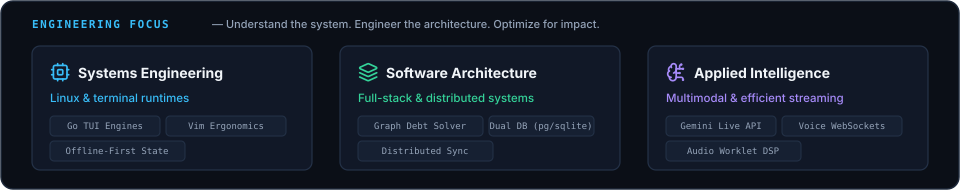

<div align="center">

<picture>
  <source media="(prefers-color-scheme: dark)" srcset="https://raw.githubusercontent.com/mudoker/mudoker/main/assets/hero-banner-dark.svg">
  <source media="(prefers-color-scheme: light)" srcset="https://raw.githubusercontent.com/mudoker/mudoker/main/assets/hero-banner-light.svg">
  
</picture>

<br/>

<p align="center">
  Software and systems engineer focused on high-performance architectures, low-level Linux systems, and practical artificial intelligence.
</p>

<p align="center">
  <a href="https://github.com/mudoker"> GitHub</a> &bull;
  <a href="https://linkedin.com/in/mudoker"> LinkedIn</a> &bull;
  <a href="mailto:huuquoc7603@gmail.com"> Email</a>
</p>

---

</div>

##  Engineering Focus

<picture>
  <source media="(prefers-color-scheme: dark)" srcset="https://raw.githubusercontent.com/mudoker/mudoker/main/assets/engineering-focus-dark.svg">
  <source media="(prefers-color-scheme: light)" srcset="https://raw.githubusercontent.com/mudoker/mudoker/main/assets/engineering-focus-light.svg">
  
</picture>

---

##  Selected Projects

Curated systems, developer tooling, applied intelligence, and algorithmic platforms.

<br/>

### [`libfprint-goodix-521d`](https://github.com/mudoker/libfprint-goodix-521d) &mdash; Hardened Linux Biometric Driver

Open-source Linux driver for Goodix 52XD biometric sensors. Eliminates impostor unlocks and false rejections through hardware bad-pixel correction and minutiae filtering.

<picture>
  <source media="(prefers-color-scheme: dark)" srcset="https://raw.githubusercontent.com/mudoker/mudoker/main/assets/pipeline-libfprint-dark.svg">
  <source media="(prefers-color-scheme: light)" srcset="https://raw.githubusercontent.com/mudoker/mudoker/main/assets/pipeline-libfprint-light.svg">
  
</picture>

- Achieved 0.0% False Accept Rate (FAR) by interpolating static DC defect offsets in raw sensor space.
- Implemented 5-frame temporal ADC noise averaging and 2&times;2 bilinear upscaling for NIST NBIS `mindtct`.

`C` &bull; `Linux libfprint` &bull; `GLib` &bull; `Meson` &bull; `NIST NBIS` &bull; [View Repository &rarr;](https://github.com/mudoker/libfprint-goodix-521d)

---

### [`stream`](https://github.com/mudoker/stream) &mdash; Vim-First Terminal Calendar &amp; Agile Engine

High-performance, Vim-first terminal calendar and agile sprint execution engine built in Go. Bridges deep time-blocking and backlog triage with zero mouse latency.

```text
┌────────────────────────────────── STREAM TUI ENGINE ──────────────────────────────────┐
│ [1] Dashboard    [2] Month Grid    [3] Sprint Kanban    [4] Week Matrix    [5] Timeline │
│  BACKLOG (Vim motions)        │ IN PROGRESS                   │ DONE                  │
│  ├─ [CORE] SQLite WAL Engine  │ ├─ [TUI] Viewport refactor    │ ├─ [VIM] Motions OK   │
│  └─ [AUTH] Google OAuth2      │ └─ [API] Bi-directional sync  │ └─ [LOG] Audit trail  │
│  :help  :sync  :view <kanban>                         [Mem: <15MB]  [Latency: <1ms]   │
└───────────────────────────────────────────────────────────────────────────────────────┘
```

- 6 cohesive perspective views rendered at 60fps with pure home-row Vim modal navigation.
- Offline-first JSON ledger with optimistic local writes and bi-directional Google Calendar sync.

`Go 1.21+` &bull; `Bubble Tea` &bull; `Lip Gloss` &bull; `Google Calendar API` &bull; `TUI` &bull; [View Repository &rarr;](https://github.com/mudoker/stream)

---

### [`dodo`](https://github.com/mudoker/dodo) &mdash; Real-Time Multimodal Voice Interrogation Engine

Interactive noir interrogation game powered by the Google Gemini Multimodal Live API. Explores real-time bidirectional audio streaming and dynamic conversational state.

<picture>
  <source media="(prefers-color-scheme: dark)" srcset="https://raw.githubusercontent.com/mudoker/mudoker/main/assets/pipeline-dodo-dark.svg">
  <source media="(prefers-color-scheme: light)" srcset="https://raw.githubusercontent.com/mudoker/mudoker/main/assets/pipeline-dodo-light.svg">
  
</picture>

- Full-duplex PCM 16kHz audio streaming over WebSockets with custom Audio Worklet VU meter.
- Dynamic state machine modulating detective personas and scoring conversational alibis.

`TypeScript` &bull; `Next.js 19` &bull; `Tailwind CSS v4` &bull; `Gemini Live API` &bull; `Web Audio` &bull; [View Repository &rarr;](https://github.com/mudoker/dodo)

---

### [`ledger`](https://github.com/mudoker/ledger) &mdash; Group Expense Ledger with Settlement Optimization

Smart multi-currency group expense ledger. Employs graph-based debt minimization algorithms to compress complex multi-party balances into minimal direct transfers.

- Computes minimal cash transfer flows across arbitrary N-party transaction webs.
- Dual-layer persistence with serverless Neon PostgreSQL and local offline SQLite fallback.

`TypeScript` &bull; `Next.js 16` &bull; `Tailwind CSS` &bull; `PostgreSQL` &bull; `Zustand` &bull; `PWA` &bull; [View Repository &rarr;](https://github.com/mudoker/ledger)

---

##  Technology Ecosystem

<picture>
  <source media="(prefers-color-scheme: dark)" srcset="https://raw.githubusercontent.com/mudoker/mudoker/main/assets/tech-stack-dark.svg">
  <source media="(prefers-color-scheme: light)" srcset="https://raw.githubusercontent.com/mudoker/mudoker/main/assets/tech-stack-light.svg">
  
</picture>

---

##  Technical Interests

<code>Efficient AI Inference</code> &bull;
<code>Linux &amp; Systems Programming</code> &bull;
<code>Distributed Systems</code> &bull;
<code>High-Performance Computing</code> &bull;
<code>Intelligent Applications</code>

---

##  Activity &amp; Overview

<picture>
  <source media="(prefers-color-scheme: dark)" srcset="https://raw.githubusercontent.com/mudoker/mudoker/main/assets/metrics-dark.svg">
  <source media="(prefers-color-scheme: light)" srcset="https://raw.githubusercontent.com/mudoker/mudoker/main/assets/metrics-light.svg">
  
</picture>

---

##  Contact

<a href="https://github.com/mudoker"> GitHub</a> &bull;
<a href="https://linkedin.com/in/mudoker"> LinkedIn</a> &bull;
<a href="mailto:huuquoc7603@gmail.com"> huuquoc7603@gmail.com</a>
