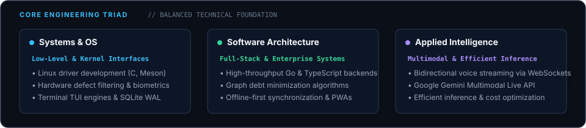
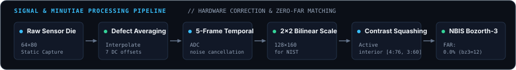
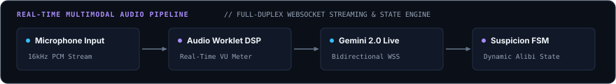
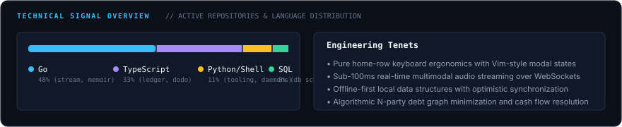

<div align="center">

<picture>
  <source media="(prefers-color-scheme: dark)" srcset="assets/hero-banner-dark.svg">
  <source media="(prefers-color-scheme: light)" srcset="assets/hero-banner-light.svg">
  
</picture>

<br/>

<p align="center">
  <b>Software Engineer</b> &bull; <b>Systems Developer</b> &bull; <b>Applied AI Explorer</b>
  <br/>
  <sub>Based in Vietnam &bull; Focusing on high-performance architectures, low-level Linux systems, and accessible intelligent computing.</sub>
</p>

<p align="center">
  <a href="https://github.com/mudoker?tab=repositories"></a>
  <a href="mailto:huuquoc7603@gmail.com"></a>
  <a href="#-selected-engineering-projects"></a>
</p>

---

</div>

## 📌 Technical Philosophy

> *“If a thing is humanly possible, consider it to be within your reach.”* — Marcus Aurelius

I approach software engineering with a conviction that **understanding the layers beneath your tools yields better architecture at every level**:

* **Demystifying the Black Box**: Whether reverse engineering biometric USB sensor protocols, profiling hardware-level DC defect offsets on a silicon die, or tuning database write-ahead logs, I prefer to understand why systems behave the way they do rather than treating frameworks as magical abstractions.
* **Ergonomics & Performance First**: I value tools that respect cognitive bandwidth and machine resources. High-throughput terminal user interfaces (TUIs) built with pure Go, home-row Vim modal paradigms, and offline-first persistence provide frictionless, distraction-free execution.
* **Practical & Accessible Intelligence**: While modern AI benchmarks often chase incremental accuracy at exponential cost, my interest centers on **practical efficiency**—deploying low-latency multimodal voice streaming over WebSockets, minimizing token overhead, and exploring local, edge-optimized inference architectures that make AI affordable and truly adoptable.

---

## ⚡ Core Engineering Dimensions

<picture>
  <source media="(prefers-color-scheme: dark)" srcset="assets/pillars-dark.svg">
  <source media="(prefers-color-scheme: light)" srcset="assets/pillars-light.svg">
  
</picture>

<br/>

| Technical Domain | Core Stack &amp; Tools | Architectural Focus |
| :--- | :--- | :--- |
| **Systems &amp; Low-Level** | `C`, `Go`, `Linux Kernel / Userspace`, `Meson`, `libfprint`, `GLib`, `NIST NBIS` | Hardware defect correction, biometric minutiae extraction, ADC signal filtering, pure-Go embedded SQLite (WAL &amp; recursive CTEs). |
| **Software Architecture** | `Go`, `TypeScript`, `Next.js 16 (App Router)`, `PostgreSQL`, `Tailwind CSS`, `Zustand` | High-concurrency services, graph-based debt minimization algorithms, offline-first PWA caching, Google OAuth 2.0 with RBAC. |
| **Applied Intelligence** | `TypeScript`, `Python`, `WebSockets`, `Web Audio API`, `Audio Worklets`, `Gemini Live API` | Real-time bidirectional voice streaming, dynamic conversational state engines, token-efficient pipelines, edge inference exploration. |
| **Tooling &amp; Runtime** | `Linux (Arch / Debian)`, `Git`, `Docker`, `Bash / Shell`, `Vim / Neovim`, `Bun` | Keyboard-driven modal workflows, containerized multi-stage pipelines, automated build systems. |

---

## 🔬 Selected Engineering Projects

A curated showcase of recent engineering work spanning systems programming, terminal developer tooling, applied multimodal AI, and full-stack algorithm design.

<br/>

### 1. [`libfprint-goodix-521d`](https://github.com/mudoker/libfprint-goodix-521d) — Hardened Linux Biometric Driver with Defect Filtering

> **Stack:** `C`, `Python`, `Meson`, `libfprint`, `GLib`, `NIST NBIS Mindtct & Bozorth-3`  
> **Domain:** *Systems Programming &bull; Hardware Reverse Engineering &bull; Signal Processing*

An open-source Linux userspace driver for the **Goodix TLS 52XD (`27c6:521d`)** fingerprint sensor (found across modern ASUS ROG Zephyrus, ZenBook, and Lenovo laptops). Solved chronic community false-acceptance and rejection issues by completely overhauling the raw capture and minutiae matching pipeline.

<picture>
  <source media="(prefers-color-scheme: dark)" srcset="assets/pipeline-libfprint-dark.svg">
  <source media="(prefers-color-scheme: light)" srcset="assets/pipeline-libfprint-light.svg">
  
</picture>

* **Root Cause Discovery**: Diagnosed static DC offsets caused by physical sensor die stuck pixels (`(46,64)`, `(42,69)`, `(40,64)`, etc.) that previously produced identical artificial constellations across unrelated fingers, leading to dangerous impostor unlocks.
* **Hardware Defect Averaging**: Engineered bad-pixel interpolation replacing defective sensor coordinates with adjacent neighbor averages in raw image space prior to squashing, restoring true biological ridge flow.
* **5-Frame Temporal ADC Averaging**: Replaced legacy swipe movement estimators with a 5-frame temporal average on static press to cancel high-frequency ADC sampling noise.
* **Bilinear Upscaling for NIST NBIS**: Upscaled compact 64×80 die frames 2×2 to 128×160 pixels, allowing the NIST `mindtct` 24×24 analysis blocks to reliably extract valid minutiae.
* **Zero False Accept Rate (0.0% FAR)**: Clamped physical sensor boundaries, applied active interior percentile contrast stretching (2%–98%), and calibrated verification thresholds (`bz3_threshold = 12`), eliminating impostor matches entirely.

---

### 2. [`stream`](https://github.com/mudoker/stream) — High-Performance, Vim-First TUI Calendar & Agile Engine

> **Stack:** `Go 1.21+`, `Bubble Tea`, `Lip Gloss`, `Google Calendar API`, `JSON Ledger`  
> **Domain:** *Developer Ergonomics &bull; Terminal User Interfaces (TUI) &bull; Offline-First Systems*

A keyboard-centric terminal productivity engine built for developers who want deep time-blocking, backlog triage, and sprint planning without the latency, bloat, or context switching of browser-based project tools.

```
┌────────────────────────────────── STREAM TUI ENGINE ──────────────────────────────────┐
│ [1] Dashboard    [2] Month Grid    [3] Sprint Kanban    [4] Week Matrix    [5] Timeline │
│                                                                                       │
│  BACKLOG (h/j/k/l to move)    │ IN PROGRESS                   │ DONE                  │
│  ├─ [CORE] SQLite WAL Sync    │ ├─ [TUI] Viewport refactor    │ ├─ [VIM] Motions OK   │
│  └─ [AUTH] Google OAuth2      │ └─ [API] Bi-directional sync  │ └─ [LOG] Audit trail  │
│                                                                                       │
│  :help  :q  :sync  :perspective <view>                 [Mem: 14MB]  [Latency: <1ms]    │
└───────────────────────────────────────────────────────────────────────────────────────┘
```

* **Vim Modal Ergonomics**: Complete home-row keyboard navigation (`h`/`j`/`k`/`l`, motion jumps, search, and a `:` command palette), eliminating mouse dependency.
* **6 Unified Perspective Views**: Seamless, instantaneous transitions between Dashboard, Month Grid, Sprint Kanban, Week Matrix, Day Timeline, and Deep Work Analytics.
* **Offline-First Synchronization Architecture**: Local-first JSON ledger engine featuring optimistic local writes combined with asynchronous bi-directional Google Calendar synchronization.
* **Zero-Lag Terminal Rendering**: Leverages Charm's Bubble Tea framework (Elm architecture) with Lip Gloss for smooth 60fps rendering at minimal memory overhead (<15MB RAM).

---

### 3. [`dodo`](https://github.com/mudoker/dodo) — Real-Time Multimodal Voice Interrogation Game

> **Stack:** `TypeScript`, `Next.js (React 19)`, `Tailwind CSS v4`, `Google Gemini Multimodal Live API`, `Web Audio API`  
> **Domain:** *Applied AI &bull; Low-Latency WebSockets &bull; Real-Time Audio Streaming*

An interactive noir interrogation simulation where players face off against an aggressive AI detective. Explores real-time multimodal interaction through low-latency full-duplex voice streaming.

<picture>
  <source media="(prefers-color-scheme: dark)" srcset="assets/pipeline-dodo-dark.svg">
  <source media="(prefers-color-scheme: light)" srcset="assets/pipeline-dodo-light.svg">
  
</picture>

* **Full-Duplex Voice Streaming**: Connected to `gemini-2.0-flash-live-001` via direct bidirectional WebSockets (`wss://`), achieving natural conversational interruption and immediate audio synthesis.
* **In-Browser Audio Pipeline**: Captures PCM 16-bit 16kHz audio from the client microphone and streams synthesize voice responses through the Web Audio API with minimal round-trip latency.
* **Custom Audio Worklet VU Meter**: Implemented an Audio Worklet tracking real-time sound decibels and driving ambient procedural particle animations without choking the UI thread.
* **Dynamic Suspicion State Machine**: A mathematical game loop that dynamically scores player alibis, adjusts detective hostility across five distinct mood tiers, and handles victory/defeat conditions.

---

### 4. [`ledger`](https://github.com/mudoker/ledger) — Group Expense Ledger with Settlement Optimization

> **Stack:** `Next.js 16 (App Router)`, `TypeScript`, `PostgreSQL (Neon)`, `SQLite`, `Zustand`, `PWA`  
> **Domain:** *Full-Stack Engineering &bull; Graph Debt Minimization &bull; Distributed State*

A multi-currency expense ledger engineered for groups and roommates. Features algorithmic debt resolution, live forex conversions, and receipt OCR parsing.

* **P2P Settlement Minimization**: Formulates debts as a directed graph and calculates minimum cash transfers required to resolve all party balances, compressing complex multi-person debt webs into minimal direct transactions.
* **Multi-Currency Dynamic Normalization**: Live currency exchange powered by the Frankfurter API v2 with intelligent local caching and offline fallback rates.
* **Dual Persistence Layer**: Hybrid database architecture supporting serverless Neon PostgreSQL for production cloud collaboration alongside local SQLite persistence for zero-connectivity environments.
* **RBAC & Guest Access**: Secure Google OAuth 2.0 authentication with role-based member permissions and signed read-only links for public bill auditing.

---

### 5. [`memoir` (FlashTUI)](https://github.com/mudoker/memoir) — Local-First Terminal Spaced Repetition Engine

> **Stack:** `Go`, `Bubble Tea`, `SQLite (pure Go / WAL)`, `Recursive CTE`  
> **Domain:** *Developer Tooling &bull; Embedded Storage &bull; Memory Optimization*

A local-first, distraction-free flashcard and spaced repetition application engineered natively for the command line.

* **Pure-Go Embedded SQLite**: Configured with Write-Ahead Logging (WAL) and recursive Common Table Expressions (CTEs) for lightning-fast hierarchical deck queries without dynamic CGO bindings.
* **Modal Review Flow**: Keyboard-driven navigation with Vim movement bindings (`h`/`j`/`k`/`l`, `gg`, `G`, `:`) for rapid review sessions.
* **Leech Detection & Rollback Engine**: Dynamic card difficulty heuristics that flag recurring retention failures, backed by transactional snapshot states for instant review undos.

---

## 🔭 Technical Horizons & Current Research

Areas I am actively researching and building experiments around:

* **Efficient AI Inference**: Profiling token economics, speculative decoding, and quantized Small Language Models (SLMs) on consumer hardware to lower latency and bypass cloud API cost ceilings.
* **WebAssembly Systems**: Compiling performant Rust engines to WebAssembly with aggressive optimization passes (`wasm-opt -O4`) for browser sandboxing and high-speed client-side computations (explored in [`replay`](https://github.com/mudoker/replay)).
* **Resilient Distributed Architectures**: Event-driven concurrency patterns, state synchronization across unreliable networks, and local-first data integrity.

---

## 📊 Technical Signals & Overview

<picture>
  <source media="(prefers-color-scheme: dark)" srcset="assets/metrics-dark.svg">
  <source media="(prefers-color-scheme: light)" srcset="assets/metrics-light.svg">
  
</picture>

---

## 📬 Connect & Collaborate

I welcome discussions around systems engineering, Linux drivers, efficient AI architectures, or interesting open-source projects.

* **GitHub**: [@mudoker](https://github.com/mudoker)
* **Email**: [`huuquoc7603@gmail.com`](mailto:huuquoc7603@gmail.com)
* **Location**: Ho Chi Minh City, Vietnam `[10.8231° N, 106.6297° E]`

<br/>

<div align="center">
  <sub>Engineered with precision. All SVGs are native, theme-adaptive, and zero-dependency.</sub>
</div>
