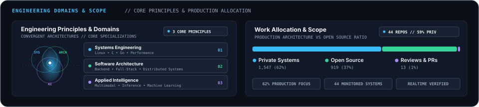
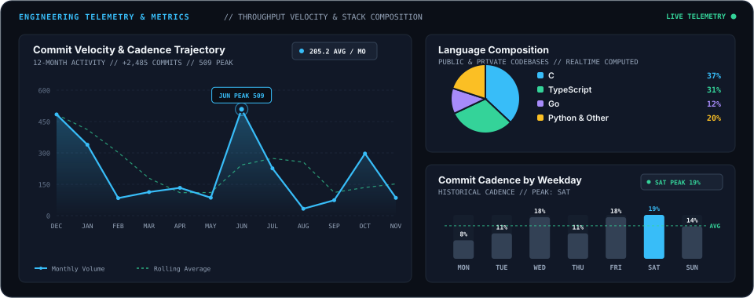
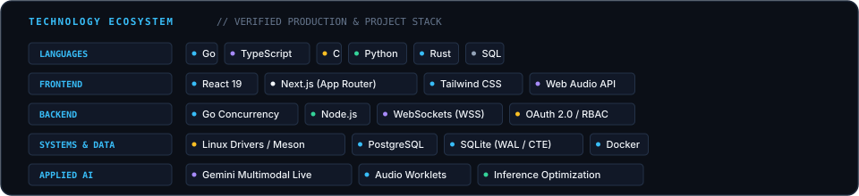

<picture>
  <source media="(prefers-color-scheme: dark)" srcset="https://raw.githubusercontent.com/mudoker/mudoker/main/assets/hero-banner-dark.svg">
  <source media="(prefers-color-scheme: light)" srcset="https://raw.githubusercontent.com/mudoker/mudoker/main/assets/hero-banner-light.svg">
  
</picture>

 

  Software and systems engineer focused on high-performance architectures, low-level Linux systems, and practical artificial intelligence.

  <a href="https://github.com/mudoker"> GitHub</a> &bull;
  <a href="https://linkedin.com/in/mudoker"> LinkedIn</a> &bull;
  <a href="mailto:huuquoc7603@gmail.com"> Email</a>

---

##  Activity &amp; Overview

<picture>
  <source media="(prefers-color-scheme: dark)" srcset="https://raw.githubusercontent.com/mudoker/mudoker/main/assets/overview-activity-dark.svg">
  <source media="(prefers-color-scheme: light)" srcset="https://raw.githubusercontent.com/mudoker/mudoker/main/assets/overview-activity-light.svg">
  
</picture>

---

##  Engineering Telemetry

<picture>
  <source media="(prefers-color-scheme: dark)" srcset="https://raw.githubusercontent.com/mudoker/mudoker/main/assets/telemetry-dark.svg">
  <source media="(prefers-color-scheme: light)" srcset="https://raw.githubusercontent.com/mudoker/mudoker/main/assets/telemetry-light.svg">
  
</picture>

---

##  Technology Ecosystem

<picture>
  <source media="(prefers-color-scheme: dark)" srcset="https://raw.githubusercontent.com/mudoker/mudoker/main/assets/tech-stack-dark.svg">
  <source media="(prefers-color-scheme: light)" srcset="https://raw.githubusercontent.com/mudoker/mudoker/main/assets/tech-stack-light.svg">
  
</picture>

---

##  Contact

<a href="https://github.com/mudoker"> GitHub</a> &bull;
<a href="https://linkedin.com/in/mudoker"> LinkedIn</a> &bull;
<a href="mailto:huuquoc7603@gmail.com"> huuquoc7603@gmail.com</a>
